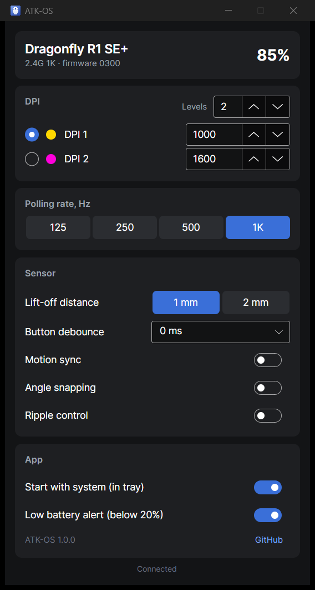

<p align="center"></p>

<h1 align="center">ATK-OS</h1>

<p align="center">
  Lightweight, open-source settings app for ATK / VXE / VGN gaming mice —<br>
  an alternative to the official <b>ATK V HUB</b>.
</p>

<p align="center">
  <a href="https://github.com/adilzhanIS7/atk-os/releases/latest"></a>
  <a href="https://github.com/adilzhanIS7/atk-os/actions/workflows/build.yml"></a>
  <a href="LICENSE"></a>
  
</p>

<p align="center"></p>

> Unofficial project. Not affiliated with ATK, VXE or VGN.

The official app is an Electron bundle of ~430 MB with analytics and a built-in web server.
ATK-OS is a small native app in the spirit of [G-Helper](https://github.com/seerge/g-helper):
it sits in the tray, shows the battery level on its icon, and talks to the mouse directly over USB HID.
No telemetry, no accounts, no network.

|  | ATK V HUB | ATK-OS |
|---|---|---|
| Download | ~430 MB | ~15 MB installer |
| Memory, idle in tray | Chromium + Node.js | ~5 MB |
| Runtime | bundled Chromium | none (native AOT) |
| Telemetry | Sentry, analytics | none |

## Download

Get the latest version from [Releases](https://github.com/adilzhanIS7/atk-os/releases/latest):

| System | File | |
|---|---|---|
| **Windows 10/11** | `ATK-OS-Setup-<version>-x64.exe` | installer: Start menu, autostart, uninstaller |
| | `atk-os-<version>-win-x64-portable.zip` | portable, no installation |
| **Linux** (Ubuntu, Debian, Mint, Pop!_OS…) | `atk-os_<version>_amd64.deb` | `sudo apt install ./atk-os_*.deb` |
| **Linux** (other distros) | `atk-os-<version>-linux-x64.tar.gz` | see [Linux](#linux) |
| **macOS 11+** (Apple Silicon) | `ATK-OS-<version>-macos-arm64.dmg` | drag ATK-OS to Applications |

The installer does not need administrator rights: it installs for the current user.
Only one copy of the app runs at a time; launching it again opens the existing window.

### "Windows protected your PC"

The builds are not code-signed yet, so Windows SmartScreen may show this warning for a new download.
Click **More info → Run anyway**. Every file is built from this repository by GitHub Actions;
checksums are in `SHA256SUMS.txt` next to the downloads:

```powershell
Get-FileHash .\ATK-OS-Setup-1.0.0-x64.exe
```

### macOS first launch

The app is not notarized by Apple. On first launch, right-click **ATK-OS** in Applications → **Open**,
or run `xattr -dr com.apple.quarantine /Applications/ATK-OS.app` once.

## Features

- Battery level in the tray icon (green / orange / red, blue while charging)
- Low-battery popup (below 20%, once per discharge)
- Start with system, straight to the tray
- DPI levels: values, number of levels, active level, indicator colors
- Polling rate (125 Hz – 8 kHz, depending on the receiver)
- Lift-off distance, button debounce
- Motion sync, angle snapping, ripple control
- `atkctl` command-line tool for scripting and diagnostics

Every change is read back from the mouse to make sure it was stored.
Firmware updates are intentionally **not** supported.

## Supported devices

| Mouse | Connection | VID:PID | Status |
|---|---|---|---|
| VGN Dragonfly R1 SE+ | 2.4 GHz receiver | `373B:1085` | ✅ tested |
| Compx-based mice (Dragonfly F1 / R1, Blazing Sky, MAD R, …) | receiver / wired | `373B:*`, `3554:*` | ❓ should work, needs testers |

Have another model? Run `atkctl info -v` and [open an issue](https://github.com/adilzhanIS7/atk-os/issues) with the output.

## Command line

```
atkctl list                      list detected devices
atkctl info                      show mouse status and settings
atkctl dump [file]               back up the mouse EEPROM to a file
atkctl set rate 1000             polling rate, Hz
atkctl set dpi 1 1600            DPI of level 1
atkctl set slot 2                switch to DPI level 2
atkctl set lod 1                 lift-off distance, mm
atkctl set debounce 4            button debounce, ms
atkctl set motionsync on         also: anglesnap, ripple
```

`atk-os --tray` starts the app hidden in the tray (this is what autostart uses).

## Linux

The `.deb` package installs everything, including a udev rule that lets the logged-in user access
the mouse without root. Re-plug the receiver after installing.

With the `.tar.gz`, install the rule by hand:

```
sudo cp 70-atk-os.rules /etc/udev/rules.d/
sudo udevadm control --reload-rules && sudo udevadm trigger
```

## Building

Requires the .NET 8 SDK.

```
dotnet build
dotnet test
dotnet run --project src/AtkOs.App
```

The tests run the protocol code against an emulated mouse, so no hardware is needed.
They include packets captured from a real mouse.

Native build (needs the platform C/C++ toolchain: Visual Studio Build Tools
with "Desktop development with C++" on Windows, clang on Linux, Xcode on macOS):

```
dotnet publish src/AtkOs.App -c Release -r win-x64 -o out
```

Installers are built by [GitHub Actions](.github/workflows/build.yml) on every push
(scripts in [`packaging/`](packaging)). Pushing a tag like `v1.2.0` publishes a release.

| Path | |
|---|---|
| `src/AtkOs.Core` | protocol and HID transport (no UI) |
| `src/AtkOs.App` | Avalonia tray app |
| `src/AtkOs.Cli` | `atkctl` |
| `tests/AtkOs.Core.Tests` | tests with an emulated mouse |
| `docs/PROTOCOL.md` | protocol notes |
| `packaging/` | Windows installer (Inno Setup), `.deb`, macOS `.dmg` |

## License

[MIT](LICENSE)
